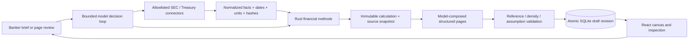

> Current scope, 23 October: external API/model connections are deferred by the owner. The primary architecture now uses the official MCP SDK, canonical evidence/context and a scene compiler. See [current architecture](MCP_ARCHITECTURE.md) and [peer research](PEER_ARCHITECTURE_RESEARCH.md). This document below records the preceding implementation and its historical checks.

# Agent workflow correction — 23 October 2026

The previous application put manual assumption forms and a six-section template at its centre. That did not implement the owner's intended interaction. The primary React entry now uses `AgentStudio.tsx`; the old workspace source and APIs are retained for compatibility with existing local state, and are not the drafting agent.

## Execution contract

The model returns one schema-constrained `{tool, arguments}` decision per turn. `arguments` is a JSON string parsed and checked by the application. This is an application-owned action/observation protocol, **not a provider-native function-calling implementation or an Agent SDK integration**. The loop invokes a selected backend anew with explicit room state and observations. It ends at a validated compose or a focused clarification. Model access alone never writes a draft. Unknown tools/arguments fail closed. Data and calculation tools update staged run memory; the final successful compose/clarification commits the room atomically after an expected-revision check. Failed/cancelled/interrupted runs leave the last draft unchanged. Start itself records the banker instruction and run ID for recovery.

| Tool | Boundary |
|---|---|
| `company_catalog` | PEP, CPB, GIS; annual US GAAP only |
| `fetch_company_facts` | Fixed `data.sec.gov` company-facts URLs, reviewed tag mappings, units/period/filing/accession retained |
| `fetch_treasury_curve` | Fixed U.S. Treasury XML feed, latest eligible dated observation, eight par-yield tenors |
| `calculate_finance` | Exact required transaction parameters, supported issuer/target references, finite/range checks, source snapshots; Rust computes all outputs |
| `compose_materials` | Typed pages/blocks; no arbitrary HTML/CSS/JS or source URLs; every bound analysis must exist and disclose assumptions; sources required |
| `ask_banker` | A focused missing term/unsupported coverage question; no invented draft |

No anonymous arbitrary URL fetcher, filesystem tool, shell, arbitrary code runner, outbound email or external MCP catalog is exposed to the model. Connector failures return an error or explicit dated fallback according to the banker's cache setting. A SHA-256 digest identifies each normalized source payload; it is not an external attestation. Retrieval does not confer licensing rights or establish financial accuracy.

## Runtime and persistence

One active model run per local server; maximum 14 decisions, 100 seconds per local model request, ten minutes total; public requests time out at 25 seconds and are bounded to 20MB after receipt. Cancellation interrupts an in-flight model future and kills its local child on drop. Network time and provider usage are not local CPU work. There is no guaranteed completion latency or subscription throughput. Model usage/cost estimates are recorded when returned; they are not subscription token allowances or an invoice.

Tables: `agent_rooms` holds committed conversation/draft/source/analysis/history; `agent_runs` holds durable state; `agent_events` holds ordered calls, outcomes and usage; `connector_cache` holds normalized fetched observations. Each committed history item captures the draft with its actual source and analysis objects. Version checks guard both human saves and agent commits. Restart marks running jobs failed rather than claiming they finished. This is single-user local history, not a bank records system, maker/checker control or cross-user tenancy boundary. History retention/context compaction and multi-user scheduling are later work.

The financial engine accepts issuer/target context instead of hardcoded PepsiCo/Campbell symbols. It remains deliberately narrow. Acquisition periods are disclosed without calendarization. EBITDA is operating income + D&A, not adjusted/covenant EBITDA. Current debt, cash, diluted shares and historic earnings cannot supply forecast valuation, transaction shares or current stock prices. All transaction terms are separately exposed as assumptions with rationale.

## Model connections

The local Claude adapter invokes the installed CLI with `--safe-mode`, no built-in tools, strict empty MCP configuration, no skill/slash commands, no user/project/local settings sources, hooks disabled and no session persistence. It runs outside the repository in an empty temporary working directory. Authentication stays inside the CLI; the app neither extracts OAuth tokens nor imports credentials. `CLAUDE_BIN`/`CLAUDE_MODEL` are server-owner configuration, not model-call arguments. Admin-managed policies still apply. Provider retention for a personal subscription is not ZDR.

Official Anthropic documentation inspected 23 October documents [`claude -p`](https://code.claude.com/docs/en/headless) and currently permits [Agent SDK / CLI / third-party personal usage through plan limits](https://support.claude.com/en/articles/15036540-use-the-claude-agent-sdk-with-your-claude-plan). This is the owner's local external demo route, not a bank route or an unlimited runtime entitlement. The actual Max request returned provider HTTP 429 / `usage_limit_reached`; no successful live draft has yet been verified.

The optional OpenAI adapter uses the [Responses API](https://developers.openai.com/api/reference/resources/responses/methods/create), `store:false`, a strict action schema and bounded output. It sends public workroom context, not keys, to the model. It does not use provider-stored conversation state or replay provider reasoning items, because each decision is a fresh request with explicit application state. `store:false` alone does not establish zero retention. No OpenAI key was available during this implementation; live text/audio calls remain unverified. Voice recording submits audio for transcription and puts the transcript in the same brief/review composer, under banker control. Full duplex page-aware voice is not part of this correction.

## Dynamic design and branding

The model chooses 2–12 pages, sequence, headline, 1–4 content blocks and cover/split/full/grid composition. This is a bounded visual grammar, not six hardwired slide contents and not arbitrary generated application code. Figures bind to actual source/calculation identifiers. Numeric narrative is rejected so the main body cannot silently duplicate stale model-written figures; headline and qualitative narrative claims still require review. Density limits are structural heuristics and do not guarantee every composition fits at every viewport. Visual review is still required.

The actual public investor-site inline SVG path is stored in `frontend/public/rabobank-wordmark.svg`. The site's public font declarations identify Myriad (light/regular/bold), with the regular file identifying `MyriadW01-Regular`. Those files are installed only in `.local/brand` on the owner's Mac. They are ignored and are not inside the public repo or application bundle. The packaging utility copies available fonts only to that same owner's local Application Support folder. Website assets came through ordinary access to the [public investor page](https://www.rabobank.com/about-us/investor-relations/presentations); direct server download attempts returning HTTP 403 were not circumvented. The browser fetched its ordinarily accessible public font assets. This establishes the website font/wordmark match, not a licence for redistribution or pixel identity with the PDF's customized MyriadforRabobank family. Read-only inspection compared 98 shared regular-font codepoints: 97 normalized advance widths match, but recorded outline descriptions differ and raster equivalence was not established. The PDF light font is a sparse embedded subset, not a complete reusable typeface. A full authorized customized font package is still needed to claim general PDF typography parity.

## Evidence

- TypeScript and production React build pass.
- Rust unit tests cover draft references, required assumption/source blocks, variable page counts, prohibited numeric narrative/arbitrary properties, SEC units/filings/required fields and Treasury observation selection, plus retained financial tests.
- `scripts/verify_agent.py` uses an explicitly mocked model process and isolated database. It tests clarification, stale start, provider quota, denied tools/step cap, cancellation, real connector retrieval/fallback, calculation bindings, human saves, concurrent edit protection and restart recovery. It is not live model or financial expert sign-off.
- `scripts/verify_demo.py` covers the retained deterministic API; historical evidence is not presented as new agent acceptance.
- Browser checks confirm the public SVG and local Myriad weights load, conversation-first navigation and honest live quota failure. A successful live first draft and conversational redraft remain blocked by model capacity.

## Acceptance still open

Live model draft → inspect financial results/source vintage → page-by-page refinement → financial/banker approval → Monday rehearsal. Optional audio requires a permitted API key and microphone test. Bank models, confidential processing, native managed distribution, SSO, licensed feeds, institutional valuations, editable PPTX and production controls remain outside this local correction.
