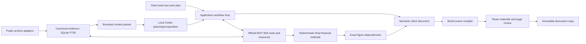

# Client decision workroom

23 October 2026. This is the current local MVP, above the [MCP/evidence foundation](MCP_ARCHITECTURE.md). It implements a preparation and review job around a client decision. The owner subsequently expanded the scope to a real director-led local agent and public ingestion. The [local Codex adapter](LOCAL_AGENT.md) now performs bounded planning and composition using the laptop’s saved login; public SEC/Treasury refresh feeds retained pool versions. Licensed feeds, remote API/voice adapters and bank integration remain separate.

## The product boundary

The main object is an engagement: what the CFO must decide, decision owner, meeting, criteria, constraints, explicit funding requirement where relevant, accountable work items and acceptance criteria. Its output is a qualified discussion argument and reviewable materials. A chat message, a calculation and a slide are different records.

The primary route is **Director assignment → Storyline → dynamic client frames → discussion/review**. Decision, work-plan, scenario and evidence editors are secondary inspection surfaces. The discussion rail can request another actual local agent turn. The banker can approve an illustrative plan, amend the brief, change structured assumptions, recompute one action, choose a conditional preference, edit page composition and inspect exact evidence. New client intent does not require manual entry of reported financials. The agent proposes brief/term changes and narrative; typed validation and deterministic calculation remain authoritative. See [the broader client-work catalog](CLIENT_WORK_CATALOG.md) for implemented and future modelling modules.

The public archive supports annual US GAAP statements for PEP, CPB and GIS and a dated Treasury par curve. Equity prices, credit spreads and deal terms are visible assumptions. The two action cases and status quo serve one comparable decision. Acquisition stresses belong to the relevant funding action, rather than masquerading as separate management choices. Full underwriting, forecasts, DCF/LBO, merger accounting and institutional transaction coverage are excluded.

## Runtime and authoritative state

One Rust process embeds the built React/TypeScript frontend and uses SQLite. The application binds to loopback. The official `rmcp` client/server exchanges actual MCP messages over an in-process duplex transport; a stdio server is also available. No microservice cluster, vector server or external model runtime is required. MCP is the capability boundary; it does not replace financial semantics, storage, context selection or orchestration.

| Module | Responsibility |
|---|---|
| `director.rs`, `pool.rs` | Bounded local model orchestration, actual run stages and append-only public source ingestion receipts |
| `engagement.rs` | Typed briefs, accountable tasks, comparable actions/stresses, funding amendments, conditional advice, review dispositions and frozen copies |
| `providers.rs`, `connectors.rs`, `evidence.rs` | Explicit connection states, normalized public evidence, original units/periods and bounded retrieval |
| `mcp.rs` | Real SDK discovery, tools/resources and scoped state |
| `finance.rs`, `lineage.rs` | Deterministic methods; canonical formula descriptions; exact output/input dependencies, source tags/components and assumption rationale |
| `workflow.rs` | Optimistic revisions, atomic current-state and immutable-history persistence |
| `materials.rs` | Typed semantic pages, required client-decision blocks, data references and scene validation |
| `evaluation.rs` | Exact-copy paired observation log and quality/denominator gates; no inferred human outcomes |
| `ClientStudio`, `ClientPlan`, `ClientMaterials`, `ClientReview`, `ClientEvaluation` | Client-first React interactions; scoped draft buffers; numerical inspection; page/copy review and explicit measurement |

Current workroom JSON contains active state plus at most 100 history summaries. Complete historical snapshots reside separately in `client_revisions` and are fetched on demand. Sidebar room lists return summaries rather than every document and source. This reduces repeated serialization; it does not measure banker productivity. Historical snapshots and old financial results remain immutable. SQLite commits use expected-revision checks to reject stale edits.

## Financial and review invariants

- Source observations retain raw and normalized values, scale, units, entity, fiscal period, filing date, accession, XBRL tag and evidence identity. Derived reported inputs disclose their component facts and definition. SEC directory and company-concept series links are labelled accurately; the prototype does not claim verified filing page anchors.
- Scenario inputs are explicitly illustrative and have a rationale. Key decision figures reveal exact values, formula and dependencies. Formula descriptions in the calculation inspection and lineage use the same percent/bps conventions. The engine's numeric output remains authoritative; authored narrative cannot replace a linked figure.
- Recalculating an action creates a new analysis ID. It preserves all old models, source snapshots and the other action, changes only dependent pages and invalidates the relevant prior judgement. Acquisition stresses recompute with the same action terms and zero synergies.
- A confirmed funding-need amendment creates new gap dependencies in the same engagement without automatically resizing notional. The banker deliberately sizes an action to the new target. Old calculations and frozen copies retain the old need. Changing the narrative question alone is not natural-language parsing of a new structured requirement.
- Client action, criteria, rationale and reversal conditions are bound into three complete pages. Summaries have explicit 300-character limits; required qualifications are not silently truncated. The comparison is a required semantic block. Other page titles, layouts, narrative and ordering can be revised within the design grammar.
- Review issues are durable page-anchored records: open, applied via an actual change, explicitly verified, or explicitly deferred with a reason. Relevant advice/brief/economic/document changes reopen affected applied, verified **and deferred** issues. Prior disposition provenance remains in historical snapshots; unrelated source checks stay scoped.
- Freezing requires complete local brief/evidence/alternatives/materials tasks, an unblocked local review, a current conditional view or explicit insufficient-evidence position, three review declarations and no open/applied issue. Manual local blockers survive subsequent commits. The permanent current-market/commercial gate stays separate and blocked.
- A discussion copy pins the full brief, tasks, conditional advice, sources, models, document, scene, issues and declarations. Later work cannot change it. Reviewer identity/qualification and declarations are self-attested in this prototype, not authenticated maker/checker authority or independently established financial acceptance.
- Review-copy and evaluation lists use bounded cursor pages with a fixed upper snapshot ID. Complete evaluation export collects every page and reconciles count/IDs, including failures. Window statistics are labelled; a recent page is never presented as the complete experiment.

Revision-scoped session buffers preserve unsaved public-prototype advice, scenario, discussion and review-note edits during source inspection. They are separated by client and committed revision; saved SQLite state remains authoritative. They are not confidential-data storage controls or multi-user collaboration. Routing and late-response checks prevent another room's response from replacing the selected client.

## Value and next phase

Five fresh GPT-6.1 Sol reviews apply a client-facing banker lens and retain their raw findings. These models are not qualified bankers and their scores are not human outcomes. [The evaluation protocol](CLIENT_WORKFLOW_EVALUATION.md) defines accepted-quality paired tasks, all-staff active minutes, elapsed time, failed-quality retention and predefined discussion-question coverage. No real paired observations exist. Neither 10× productivity nor 5× client impact has been established.

The current bounded orchestrator has demonstrated actual brief interpretation, validated financial work and generated composition; it is not unrestricted autonomous underwriting. Before wider adoption, extend qualified task evaluations, cancellation/refusal/injection tests, model/provider selection and authenticated controls. One permitted data provider requires authenticated schema/sample/rights reconciliation before activation. Voice, editable Office adapters and managed native shells follow. Bank acceptance depends on actual bank controls, contracts and operating evidence; this local code does not establish it.
