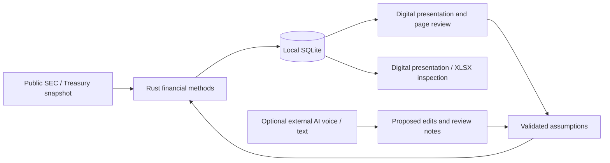

# MVP architecture and financial methods

Status: local external demonstration, 22 October 2026. Independently implemented; public-data only. For operation and limitations see [Monday demo](MONDAY_DEMO.md), [provider/platform findings](MVP_DATA_AND_PLATFORM.md), and [the original bank acceptance gates](BANK_ACCEPTANCE.md).

## Application structure

`src/finance.rs` owns financial mathematics and input limits. `src/main.rs` owns the loopback API, SQLite, revision jobs and optional provider requests. `src/workbook.rs` creates XLSX inspection copies. `public/` contains the entire small browser interface. Assets and the dated public snapshot are embedded in the release binary. Python scripts are development utilities only.

SQLite stores financial facts, method references, assumptions, immutable calculation versions, review notes, job states, optional dated quotes and exact-version demonstration freezes. A database does not acquire corporate-finance expertise by containing documents: this MVP makes financial conventions executable in Rust, and stores the methods/version identifiers alongside results. Models propose bounded input edits; they do not compute material figures or overwrite reported facts.

Each save checks the expected version. A stale save fails rather than overwriting another draft. Existing calculation snapshots remain unchanged. A demo freeze records that exact version, while further edits create another draft. This is single-user review state, not maker/checker separation of duties or a regulatory records system. Version models use the embedded public snapshot; refreshing sources requires a rebuild and fresh demo database. Durable multi-vintage source snapshots and migration controls remain future work.

## Financial conventions

**Reported inputs.** US GAAP annual company facts; fiscal years are shown explicitly. Earnings use common-shareholder earnings when available. Diluted weighted-average shares are appropriate to the illustrative EPS denominator, not automatically to transaction equity consideration; the deal share count is therefore a separate assumption. Reported diluted EPS is retained for inspection but modeled EPS uses common earnings divided by shares and can differ due to share-class allocation and rounding. Debt definitions and tags are visible. D&A plus reported operating income is an unadjusted EBITDA proxy, not adjusted/covenant/rating EBITDA.

**Bond issuance.** Regular semiannual coupon payments and redemption at 100; no accrued interest at issuance. Indicative yield is a linearly interpolated Treasury **par** yield at the chosen tenor plus an assumed credit spread. Discount every coupon and principal at a flat semiannual yield to maturity. Gross proceeds = notional × price / 100; net proceeds subtract assumed fees. Annual coupon cash cost uses notional × coupon. DV01 uses a central ±1bp yield shock. Net leverage assumes the new proceeds are deployed. This is not a bootstrapped zero-curve valuation, spread-curve fit, executable new-issue pricing, OAS or pricing of callable/convertible/irregular bonds.

**Share repurchase.** Shares retired = cash spend / assumed execution price. Reduce common earnings for lost after-tax cash interest using the dated one-year Treasury reference. Reduce the historical diluted denominator for a full modeled period. Compute EPS and compare with historical modeled EPS. This is a stylized cash-funded scenario, not a forecast or time-weighted EPS result. Cash shortages are flagged. EPS accretion does not prove value creation. Sensitivity points that would retire all modeled shares are excluded.

**Acquisition.** Equity consideration = assumed deal shares × assumed stock price × (1 + premium). Enterprise value adds reported target debt and subtracts cash. Funding splits the equity cheque between new debt and acquirer cash; target debt remains assumed outstanding. Combined earnings add target common earnings and after-tax synergies, then subtract after-tax new debt interest and forgone cash interest. Pro forma EPS uses the acquirer's diluted shares with no new issuance. Net leverage combines existing/new debt less remaining combined cash, divided by both EBITDA proxies and full assumed synergies. This excludes PPA, transaction fees, one-off integration costs, financing amortization, timing, shareholder/class complications, pension/lease/minority/associate EV adjustments and strategic/regulatory feasibility. The 3.5x discussion threshold is illustrative, not a rating rule. Fiscal periods are not calendarized.

## Presentation adaptation

References are the public [Rabobank investor presentations page](https://www.rabobank.com/about-us/investor-relations/presentations), [H1 2026 results](https://media.rabobank.com/asset/e7a03d73-245e-47a1-a3de-5517892a183b/Results-Presentation-H1-2026.pdf) and [FY2025 investor presentation](https://media.rabobank.com/asset/d6eb375a-c232-4194-b8e5-0a9a044f0a2e/Investor-Presentation-FY-2025.pdf). H1 slides were visually inspected, including the cover and financial-information layouts.

The public H1 reference uses a 4:3 canvas. The app adapts its navy/blue/orange palette, pale backgrounds, large light-weight headings, orange financial figures, blue captions, thin separators and discreet footer to 16:10 digital pages. CSS uses system Arial/Helvetica rather than proprietary Myriad for Rabobank. No original photography, proprietary font file or extracted logo artwork is bundled. A text wordmark provides the requested identity study; this is not an official bank template, endorsement or brand-approval claim. Brand-owner review and an authorized template remain necessary for real client use.

## Trust boundaries and known gaps

The server binds only to IPv4 loopback, checks Host and mutating-request Origin, and requires a random per-process token for writes. The UI escapes dynamic text and uses a restrictive CSP. Source and export routes are fixed; arbitrary filesystem paths are not served. Request size and numeric input ranges are bounded. These controls were exercised locally; they are not a security assessment.

Keys from Settings remain in server memory; environment keys can instead come from ignored `.env.local`. Keys do not enter SQLite, bootstrap responses or exports. Local SQLite is not encrypted by this app; rely on neither local storage nor loopback as protection for confidential material. There is no bank SSO, role authorization, information barrier, managed secret storage, central logging, signed installer, records retention policy or independent penetration test. The app cannot support bank deployment in its current form.

When explicitly used, external model requests send public briefing data and notes to the provider. Live voice sends microphone audio over WebRTC. Text requests use `store:false`; this is not proof of ZDR. Quote requests use a fixed provider and supported symbol allowlist. Licences, model access, retention, geographic processing and actual bank permission are unverified. Live API tests remain outstanding because no keys were provided.

## Verification evidence

Ten Rust unit tests cover pricing identities, sensitivities, input validation and review handling. The isolated integration script checks three seeded cases, independent Python recomputation of principal financial outputs, all XLSX working-result caches, revision/version behavior, unresolved notes, freeze semantics and loopback request boundaries. It does not run a full independent valuation validation or recalculate XLSX formulas in Microsoft Excel. Browser checks cover the three presentations, laptop layout and the review-to-new-version flow. See [machine-readable results](verification.json).
