# Financial-agent product patterns and architecture decisions

Research: **23 October 2026**. Public product pages, provider documentation, MCP specification and official SDK/package sources were inspected. No paid product account, vendor demonstration, licensed response or competitor private implementation was inspected. Product descriptions establish what vendors advertise; they do not establish accuracy, performance or their internal architecture. The implementation is independent. No proprietary code, customer documents or vendor datasets are copied.

The original architecture phase deferred model/data connections. The owner’s subsequent director-led steering is implemented in the [local agent and public pool](LOCAL_AGENT.md): actual local Codex planning/composition and fixed public ingestion. The foundation below and its researched boundaries remain relevant; remote/provider/API entitlements and bank acceptance are still separate.

## What the comparable products actually show

The Finster product, Model ML workflow and Rogo May-update pages were re-opened during the five-pass workroom review on 23 October. Their public descriptions continue to support source-linked workflow/artifact patterns; no vendor account or independent outcome measurement was available. [The current client-workroom implementation](CLIENT_WORKROOM_ARCHITECTURE.md) applies these patterns to a bounded CFO decision rather than claiming vendor feature parity.

| Reference and evidence | Observable pattern | What we implement from that pattern | What the evidence does not establish |
|---|---|---|---|
| [Finster product](https://www.finster.ai/product) | Cited exploration, company-oriented research, background workflows, firm-styled presentation creation and intent-shaped interactive outputs | A workroom groups conversation, evidence, analytical outputs and materials; artifacts outlive a chat turn; layout is an output decision | Its prompts, orchestrator code, exact export engine or numerical reliability |
| [Finster / Weaviate case study](https://weaviate.io/case-studies/finster) | Partner describes ingestion from financial suppliers and filings, hybrid retrieval, pre-filtering, reranking and granular citations | Keep structured financial observations separate from document retrieval; preserve entity/date metadata; select context instead of dumping a corpus into a prompt | That a small MVP needs Finster’s scale or its vector infrastructure; that their deployment approvals transfer |
| [Model ML workflows](https://modelml.com/product/workflows) | Repeatable deliverable workflows use internal and external sources and firm formats; examples include advisory materials and company profiles | Explicit workflow definitions, reusable analytical methods, a brand grammar and a document contract | Its private task graph, planner implementation or banking control evidence |
| [Model ML integrations and provenance](https://llms.modelml.com/model-ml-integrations-data-sources-and-deliverables) | Describes a workflow layer above existing data suppliers, with data-linked numeric citations and reviewable outputs | Provider adapters feed a canonical evidence layer; source identity follows figures into artifacts; data is purchased separately from orchestration | Entitlement to any named supplier, matching coverage or field semantics |
| [Rogo May product update](https://rogo.com/blog/may-product-update) | Publicly describes custom MCP connections, reusable financial agents, an artifact library and location-aware slide comments with tracked revisions | Real MCP host/client/server roles; a materials library; stable page/frame identifiers; scoped edits and version checks | Its internal model-routing logic, proprietary source code or a validated copy of the whole product |
| [Hebbia banking](https://www.hebbia.com/investment-banking/) and [Matrix](https://www.hebbia.com/matrix/) | Banking work includes company comparisons, financial analysis and CIM preparation; the public Matrix demo organizes company rows and analytical columns with source documents | An evidence/analysis surface alongside conversation and materials; comparable outputs remain structured records | That the demo companies/numbers are data we can reuse; any endorsement of the example financial judgements |
| [Daloopa MCP documentation](https://docs.daloopa.com/docs/daloopa-mcp) | Concrete discovery and retrieval tools separate company identity, financial-series discovery, values, documents and prices; outputs retain source locations | Discover entity → select metrics/periods → fetch observations → calculate → cite. Bounded queries prevent context overload | Access without an account, full financial semantics from one tool call, or a replacement for all transaction/debt datasets |
| [FactSet MCP catalog](https://developer.factset.com/mcp/factset-ai-ready-data-mcp) | Describes a financial content surface exposed through MCP | A planned provider-native MCP route alongside API-to-MCP adapters | The owner’s actual tools, commercial tier, permitted AI use or onward-output rights |
| [S&P/Kensho overview](https://docs.kensho.com/llmreadyapi/overview) and [MCP setup](https://docs.kensho.com/llmreadyapi/mcp) | API content and its MCP delivery interface are separately documented; a custom application can consume either | Treat content, transport, entitlements and our orchestration as distinct concerns | An activated integration, authenticated schema/sample validation or bank permission |

These findings support the owner’s product thesis: considerable workflow functionality can be independently assembled around existing model and data interfaces. The difficult product layer is the dependable combination of financial meaning, evidence, controlled revisions and usable deliverables. Merely placing a chat above a database does not implement that combination.

## Where MCP belongs

The [official architecture](https://modelcontextprotocol.io/docs/2026-07-28/learn/architecture) distinguishes the host application, its clients and servers exposing capabilities. MCP standardizes context/tool exchange; it does not choose an application’s financial methods, memory strategy or presentation model.

Our intended flow is:

```mermaid
flowchart LR
 A[Public / licensed / internal sources] --> B[Source adapters and provider contracts]
 B --> C[Canonical evidence / financial semantics]
 C --> D[MCP servers: tools and resources]
 D <--> E[Application MCP clients]
 E --> F[Bounded context selection]
 F --> G[Conversation and workflow host]
 G --> E
 G --> H[Semantic financial document]
 H --> I[Scene compiler and brand grammar]
 I --> J[React canvas / review / future Office export]
```

A provider that already has MCP can be connected through a provider-native client. A plain HTTP/feed source needs an adapter; our own server can expose its normalized results through MCP. Bulk ingestion, reconciliation and immutable evidence storage still belong behind those interfaces. An institution’s entire database should not be injected into every prompt.

[Tools](https://modelcontextprotocol.io/specification/2026-07-28/server/tools) expose schema-described operations and can return structured content. [Resources](https://modelcontextprotocol.io/specification/2026-07-28/server/resources) expose addressable context. Our application decides which results/resources enter a model request. Tool annotations describe intent; they are not authorization controls. Actual code enforces the allowed operations and scope.

The current official specification is **2026-07-28**, whose discovery/stateless behavior differs from older MCP introductions. We use the [official Rust SDK](https://github.com/modelcontextprotocol/rust-sdk), pinned to the inspected `rmcp 3.7.0` package, rather than inventing a JSON endpoint and calling it MCP. SDK negotiation handles current discovery and supported legacy initialization. The local host uses a real SDK client/server across a duplex JSON-RPC transport without a separate daemon. The same server is available over stdio. Remote HTTP/OAuth connections are deferred.

## Explicit boundaries

1. **Source contracts.** Provider identity, delivery mode, coverage, state, rights uncertainty and schema version belong in a registry. A planned descriptor must fail clearly if invoked, rather than return invented data. Source identity is not the same thing as a terminal subscription or a model credential.
2. **Financial evidence.** Each observation keeps canonical entity identity, raw value/unit, normalized value/scale, fiscal period, filing/publication date, accession/tag and source URI. Immutable evidence IDs distinguish corrections and restatements. Tickers are display/search aliases, not universal company/security identities.
3. **Retrieval.** Structured observations can be queried directly. Narrative documents need chunk/page/table anchors and later hybrid retrieval/reranking. The local archive uses SQLite FTS5 for keyword discovery; it does not claim embeddings or semantic search. Weaviate’s Finster case study informs the later retrieval interface, not a requirement to run a vector cluster on this Mac.
4. **Context.** An assignment selects entities and observations, attaches citation identities and includes relevant derived outputs. Serialized size is bounded; omitted evidence IDs are explicit. Character budgets are not claimed to be token budgets. Revision history and complete source payloads should not be repeated indiscriminately in model requests.
5. **Finance.** Validated deterministic methods compute outputs from evidence and explicit transaction terms. Models propose analysis or assumptions; they do not author authoritative calculated figures. Reported, estimated and scenario values require different types and visible labels.
6. **Workflow.** Discovery, evidence selection, analysis, context construction, composition and review are observable stages. A model is one replaceable decision port. The local blueprint executor exercises the same financial/document tools without pretending to understand arbitrary natural language. A saved free-form brief remains pending the deferred model port.
7. **Document.** The authoritative artifact contains semantic pages and data references. A scene compiler derives geometry, bindings, citations and review warnings under a corporate design grammar. Human layout/headline edits create revisions without rewriting the analytical records. Stable IDs support comments even when page order changes.
8. **Review/export.** A reviewer needs the exact source/analysis snapshot behind the shown revision. Text quality, number consistency and rendering fit are separate checks. A future PPTX exporter should consume the same scene/document contract, avoiding an unrelated second generation pipeline.

The corresponding current modules are `providers.rs`, `evidence.rs`, `mcp.rs`, `finance.rs`, `workflow.rs`, `materials.rs` and the React workspace. This is a modular monolith: a lightweight deployable application with genuine boundaries, not unnecessary local microservices.

## Dynamic slides: what changes

The renderer must not equate “an acquisition discussion” with a fixed six-slide deck. Its inputs are the intended narrative, available financial/evidence objects, desired emphasis and company design grammar. Pages may mix narrative, reported facts, metrics, curves, funding bars, workings, sensitivities, assumptions and sources. The model will choose semantic composition in the next phase; deterministic compilation retains data references and produces the scene.

The implemented local blueprints deliberately exercise different document shapes: financing, capital returns and a hypothetical acquisition. They use the real MCP/evidence/finance pipeline and explicitly illustrative transaction terms, with no external request. They are curated examples, not evidence of autonomous model reasoning. The UI permits per-page composition changes and page reordering, with optimistic revision checks and unchanged numeric bindings. Browser fit still requires verification; structural validation is not a promise of perfect typesetting for every possible document.

Rogo’s annotation/library descriptions inform the interaction; Model ML’s source-linked deliverables inform provenance; Finster’s interactive outputs inform intent-shaped composition. We do not claim those vendors use our scene representation or backend design.

## Open-source decisions

| Foundation inspected | Licence / fit | Decision |
|---|---|---|
| [MCP Rust SDK](https://github.com/modelcontextprotocol/rust-sdk) / [package](https://crates.io/crates/rmcp/3.7.0) | Apache-2.0; official client/server implementation | Use as the actual protocol layer; include its notice/licence. No proprietary framework source copied. |
| [Open Canvas](https://github.com/langchain-ai/open-canvas) | MIT project for conversation plus editable/versioned artifacts | Adopt the interaction pattern and separation of artifact state from chat. Do not import its full Next.js/LangGraph stack into the lightweight Rust application. |
| [PptxGenJS](https://github.com/gitbrent/PptxGenJS) / [chart API](https://gitbrent.github.io/PptxGenJS/docs/api-charts/) | MIT; structured PowerPoint objects, charts and tables | Candidate export adapter for the canonical document/scene, deferred until export scope is authorized. It is not a finance or evidence engine. |
| [Slidev](https://github.com/slidevjs/slidev) | MIT; component-based presentations and multiple output paths | Study reusable visual composition; retain the requested React frontend rather than migrate to its Vue authoring stack. |
| Existing React / SQLite / Rust and retained Tiptap foundation | Already in this repository | Reuse the current canvas, financial engine and state boundaries. Keep heavy authoring packages out of the main entry bundle when unused. |

Dependency reuse is distinct from copying competitor UI assets or proprietary implementations. The public Rabobank identity study remains separately authorized; proprietary fonts stay local and are not redistributed.

## Next phase and acceptance

Now: real local MCP discovery/calls/resources; canonical archive evidence; bounded context; deterministic financial analysis; scene compilation and scoped revisions; visible provider/model deferral. Acceptance requires actual protocol and local workflow tests plus browser review of the example materials.

Next: select one permitted provider; inspect authenticated `tools/list` and representative responses; map definitions/periods and rights; connect one approved model port; then test genuine brief → tool selection → draft → page feedback → revised draft. Add cancellation, model refusal, missing-data and prompt-injection evaluations at that boundary. Full Office export, document ingestion/hybrid search and collaborative review follow measured demand. No account key, paid subscription purchase, external outreach or bank integration is part of this phase.

Bank acceptance remains a separate programme: actual control owners, classification, permitted models/retention, entitlements, information barriers, identity, records, independent testing and operating evidence must be assessed. A protocol SDK, a vendor’s certification or a polished public-data demo cannot establish acceptance.
